

  <h1>Kernel builder for MT6768</h1>
  <h3><i>Powered By GitHub Actions</i></h3>

## Usage Guide

> [!NOTE]
> You will need a GitHub account.

  
<i>Click to expand</i>

> ### 1.
> 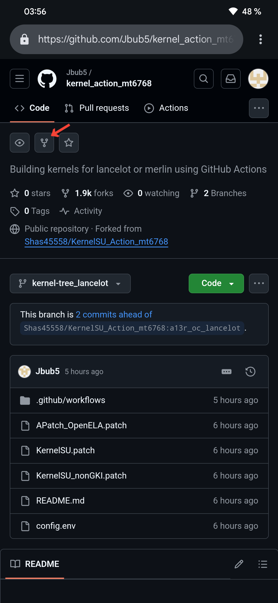

> ### 2.
> 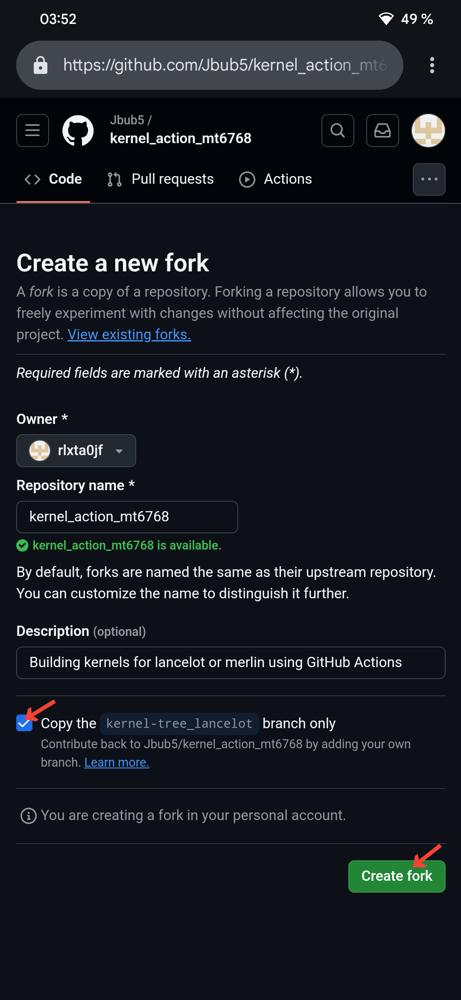

> ### 3.
> 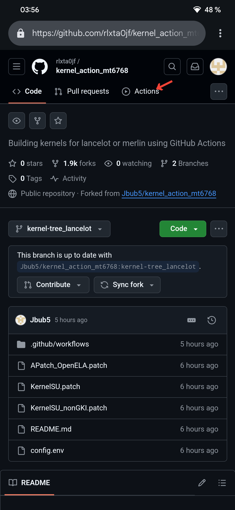

> ### 4.
> 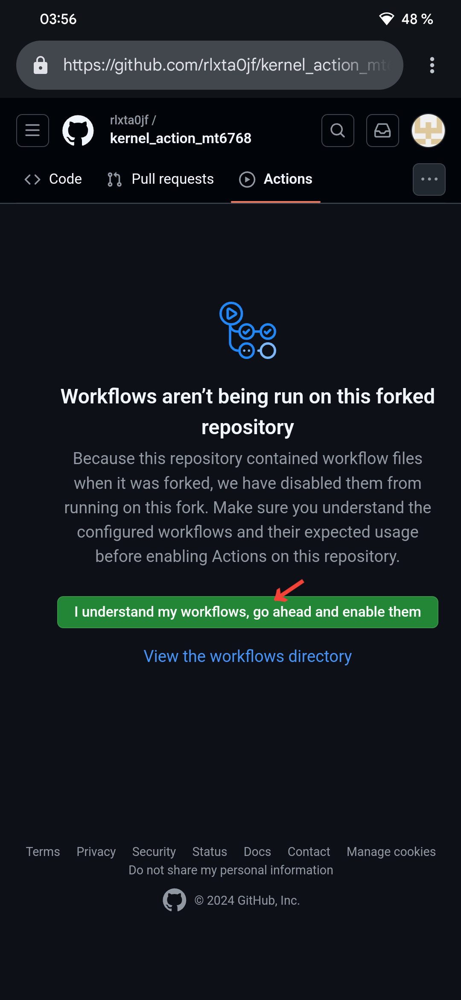

> ### 5.
> 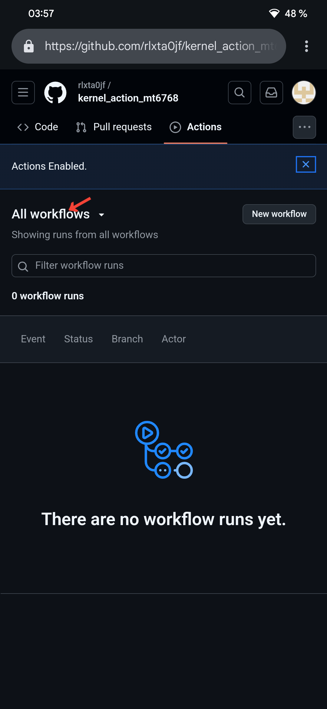

> ### 6.
> 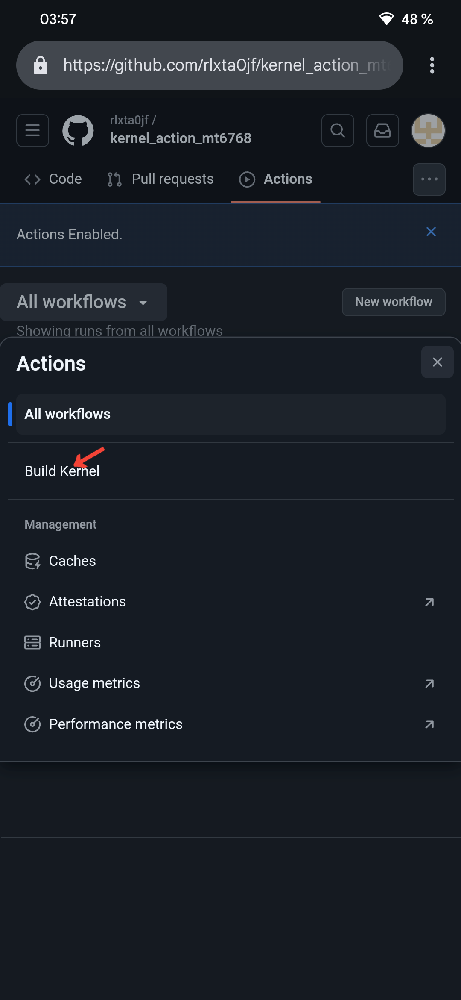

> ### 7.
> 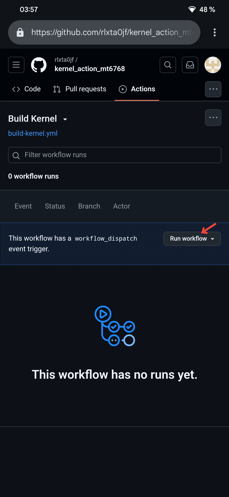

> ### 8.
> 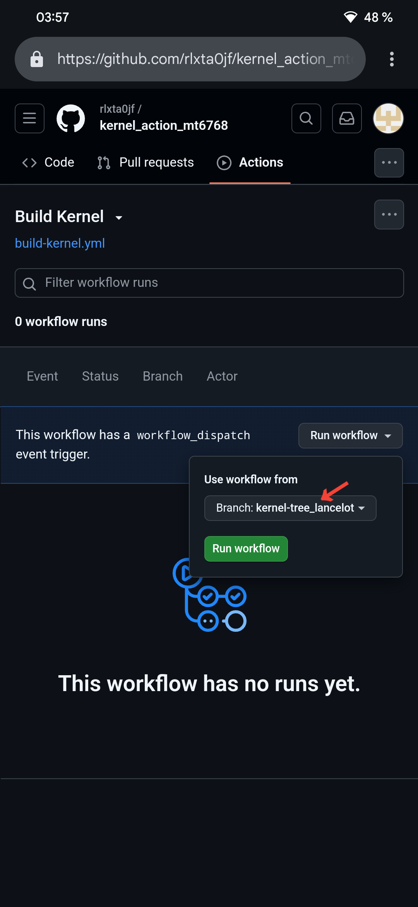

> ### 9.
> 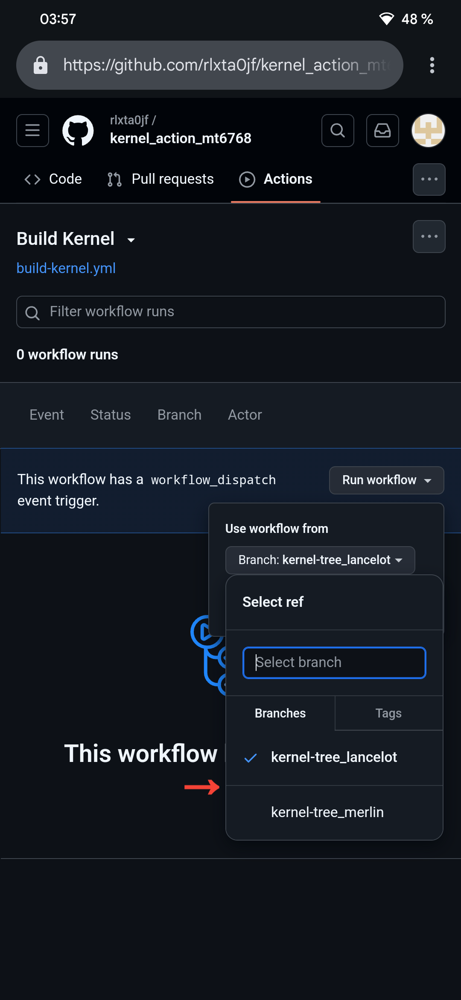

> ### 10.
> 

> ### 11.
> 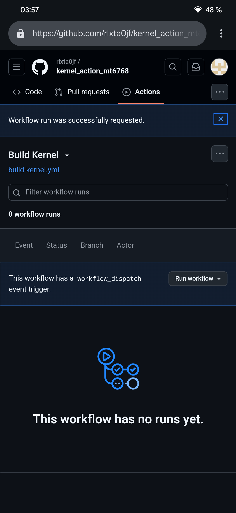
> **Note:** Reload this page if the yellow circle does not appear.

> ### 12.
> 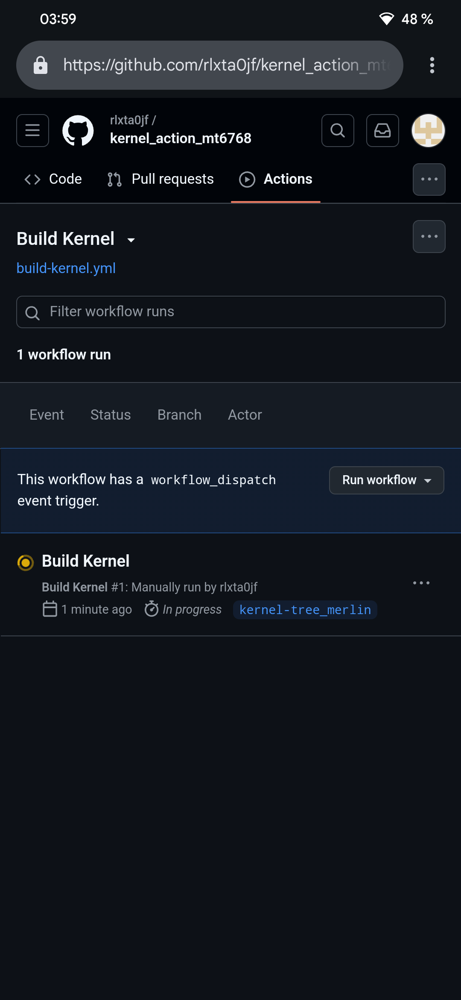

> ### 13.
> 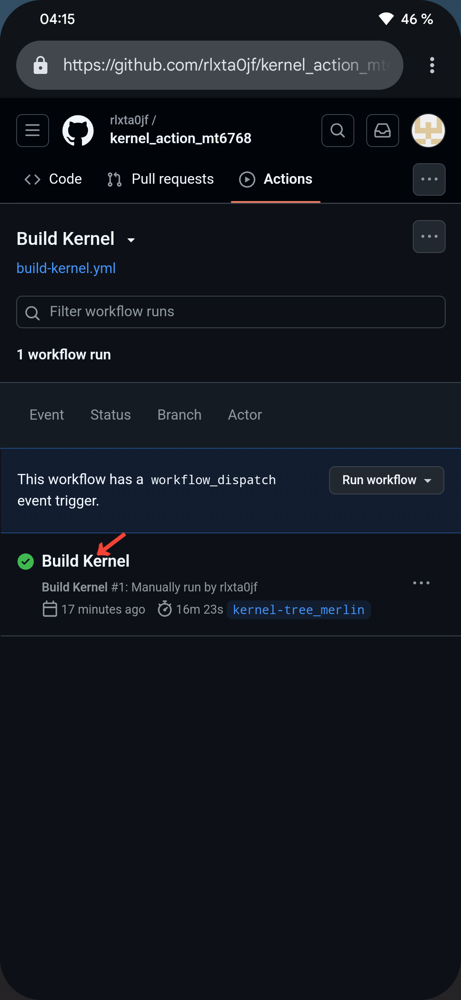

> ### 14.
> 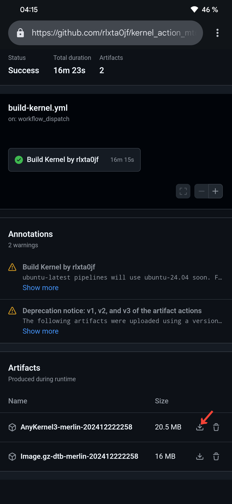

## Options Guide

> [!NOTE]
> All options are located in [config.env](config.env)

 

| Base section options | Optional | Description | Example value |
|---------------------|----------|-------------|----------------|
| KERNEL_SOURCE | 
❌
 | Link to kernel repository | `https://github.com/Jbub6/android_kernel_xiaomi_mt6768` |
| KERNEL_SOURCE_BRANCH | 
❌
 | Branch name of kernel repository | 
`kernel-tree`
 |
| KERNEL_ARCH | 
❌
 | The Linux kernel architecture | 
`arm64`
 |
| KERNEL_IMAGE_NAME | 
❌
 | Format of the kernel image for flashable AnyKernel3 zip | 
`Image.gz-dtb`
 |
| KERNEL_CONFIG_MONOLITHIC | 
❌
 | WIP | 
`false`
 |

 

| KernelSU section options | Optional | Description | Example value |
|--------------------------|----------|-------------|---------------|
| KERNELSU_ENABLE | 
✅
 | Enables accounting for the KernelSU options written below | 
`true`
 |
| KERNELSU_SETUP_SOURCE | 
❌
 | Link to KernelSU setup script | `https://raw.githubusercontent.com/tiann/KernelSU/main/kernel/setup.sh` |
| KERNELSU_TAG | 
✅
 | Repository branch or tag of KernelSU | 
`v1.0.1`
 |
| KERNELSU_REVERT_GKI | 
✅
 | Revert the [commit](https://github.com/tiann/KernelSU/commit/898e9d4f8ca9b2f46b0c6b36b80a872b5b88d899) that removed non-GKI kernel support | 
`true`
 |
| KERNELSU_EXPECTED_SIZE | 
✅
 | If not empty, this value will be set to KSU_EXPECTED_SIZE, see https://github.com/tiann/KernelSU/blob/main/kernel/Kbuild for more details | `0x033b` |
| KERNELSU_EXPECTED_HASH | 
✅
 | If not empty, this value will be set to KSU_EXPECTED_HASH, see https://github.com/tiann/KernelSU/blob/main/kernel/Kbuild for more details | `c371061b19d8c7d7d6133c6a9bafe198fa944e50c1b31c9d8daa8d7f1fc2d2d6` |
> [!IMPORTANT]
> [KernelSU](https://kernelsu.org/guide/what-is-kernelsu.html) [no longer supports non-GKI kernels](https://github.com/tiann/KernelSU/issues/1705) after version [v1.0.0](https://github.com/tiann/KernelSU/releases/tag/v1.0.0). The last supported version is [v0.9.5](https://github.com/tiann/KernelSU/releases/tag/v0.9.5), please make sure to use the correct tag.

 

| APatch section options | Optional | Description | Example value |
|------------------------|----------|-------------|---------------|
| APATCH_ENABLE | 
✅
 | Add [required configs](https://apatch.dev/install.html#install-requirements) for [APatch](https://apatch.dev/what-is-apatch.html) | 
`false`
 |

 

| Compiler section options | Optional | Description | Example value |
|--------------------------|----------|-------------|---------------|
| CC_CLANG_ENABLE | 
✅
 | Enable Clang toolchain usage and accounting for the Clang options written below | 
`true`
 |
| CC_CLANG_SOURCE | 
❌
 | Link to Clang archive or repository | `https://github.com/ZyCromerZ/Clang/releases/download/21.0.0git-20250415-release/Clang-21.0.0git-20250415.tar.gz` |
| CC_CLANG_BRANCH | 
✅
 | Branch name of Clang repository | 
`main`
 |
| CC_CMDS | 
❌
 | Compiler options | `LLVM=1 LLVM_IAS=1 CROSS_COMPILE=aarch64-linux-gnu- CROSS_COMPILE_ARM32=arm-linux-gnueabi- CROSS_COMPILE_COMPAT=arm-linux-gnueabi- CONFIG_NO_ERROR_ON_MISMATCH=y TARGET_BUILD_VARIANT=user` |

 

| Anykernel3 section options | Optional | Description | Example value |
|----------------------------|----------|-------------|---------------|
| ANYKERNEL3_ENABLE | 
✅
 | Enable creating flashable AnyKernel3 zip and accounting for the options written below | 
`true`
 |
| ANYKERNEL3_SOURCE | 
❌
 | Link to AnyKernel3 archive or repository | `https://github.com/Jbub6/AnyKernel3.git` |
| ANYKERNEL3_BRANCH | 
✅
 | Branch name of AnyKernel3 repository | 
`photon`
 |

 

| Misc section options | Optional | Description | Example value |
|-----------------------|----------|-------------|---------------|
| NEED_PYTHON2 | 
✅
 | Many old kernels require python2 to build them | 
`false`
 |
| NEED_SOME_PACKAGES | 
✅
 | WIP | 
`false`
 |

 

| Droidspaces section options | Optional | Description | Example value |
|-----------------------|----------|-------------|---------------|
| DROIDSPACES_ENABLE | 
✅
 | Add [required configs](https://github.com/ravindu644/Droidspaces-OSS/blob/main/Documentation/Kernel-Configuration.md#step-1-the-required-options) and a [patch](https://github.com/ravindu644/Droidspaces-OSS/blob/main/Documentation/resources/kernel-patches/non-GKI/02.fix_restore%20cgroup%20file%20prefix%20handling%20.patch) for [Droidspaces](https://github.com/ravindu644/Droidspaces-OSS) | 
`false`
 |

 

## Credits

- [dabao1955](https://github.com/dabao1955) for the structure of README.md
